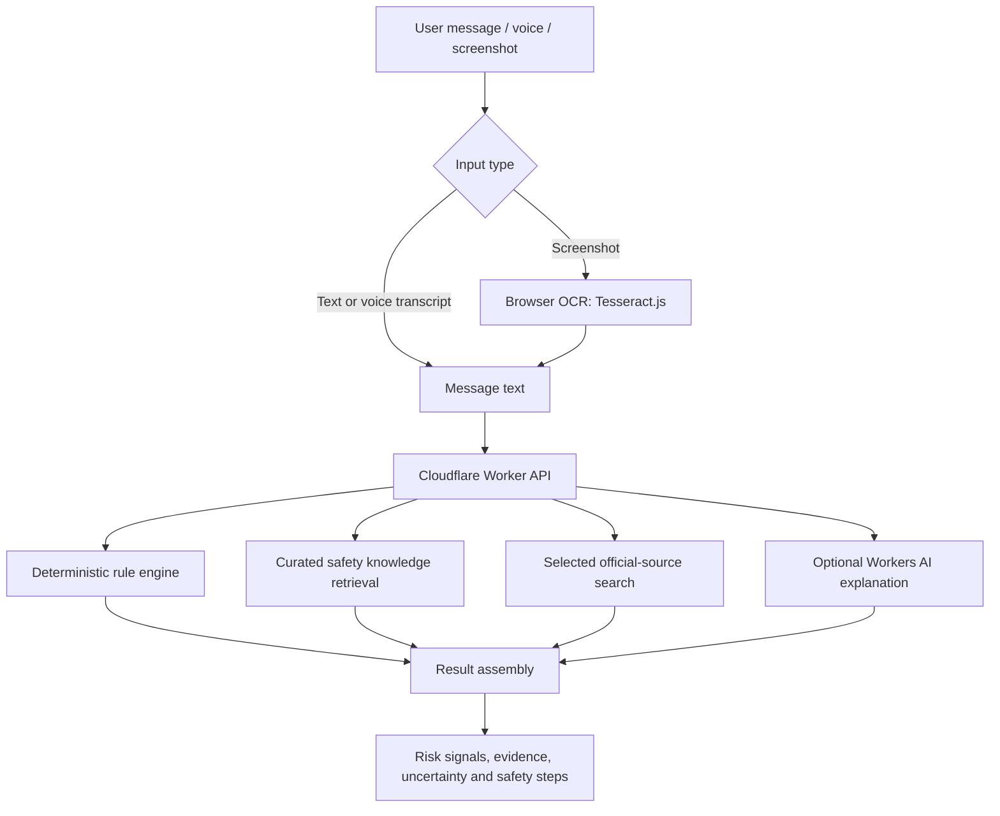

# SHONKET AI

### Detect. Understand. Practise. Protect.

**An AI-assisted scam-awareness platform that helps people examine suspicious messages, understand warning signs, and verify claims against selected official sources.**

[](https://rakibulhasanrakibofficial.github.io/shonket-ai/)
[](https://github.com/rakibulhasanrakibofficial/shonket-ai)
[](https://github.com/rakibulhasanrakibofficial/shonket-ai/actions/workflows/e2e.yml)
[](https://github.com/rakibulhasanrakibofficial/shonket-ai/actions/workflows/deploy-pages.yml)

> Built for **Ostad Presents YUNet AIgnite Buildathon 2026**.

---

**Try it:** [Launch Shonket AI](https://rakibulhasanrakibofficial.github.io/shonket-ai/) · **Explore the code:** [GitHub repository](https://github.com/rakibulhasanrakibofficial/shonket-ai) · **Report an issue:** [GitHub Issues](https://github.com/rakibulhasanrakibofficial/shonket-ai/issues)

### Contents

- [The problem](#the-problem) · [Our solution](#our-solution) · [Key features](#key-features)
- [Try a sample](#try-a-sample) · [How it works](#how-it-works) · [Tech stack](#tech-stack)
- [Architecture](#architecture) · [Live deployment](#live-deployment) · [Run locally](#run-locally)
- [Security and privacy](#security-and-privacy) · [Responsible use and limitations](#responsible-use-and-limitations) · [Validation](#validation)

---

## The problem

Scam messages often arrive through SMS, WhatsApp, Facebook, email, and fake job or scholarship announcements. They use urgency, prize claims, advance fees, suspicious links, and requests for OTPs or personal information.

People are often left with two poor choices: trust the message, or search the internet themselves and struggle to decide which sources are reliable.

## Our solution

**Shonket AI** turns a suspicious message into an understandable risk assessment. It combines explainable rule-based checks, optional AI-generated explanations, curated safety guidance, and a limited search of selected official or institutional sources.

It is designed to help users ask three practical questions:

1. **What looks suspicious?** See the warning signs and a transparent heuristic risk score.
2. **What can I verify?** Review relevant official notices or contextual safety guidance, with the evidence type clearly labelled.
3. **What should I do next?** Get practical safety steps instead of a verdict with no explanation.

## Key features

| Feature | What it does |
|---|---|
| **Scam Message Checker** | Examines message text for patterns such as OTP requests, advance fees, prize claims, urgency, and suspicious links. |
| **Bangla + English** | Supports Bangla and English analysis, with Banglish patterns covered by representative tests. |
| **Official-Source Search** | Searches a configured set of official or institutional sources for supported categories. Source coverage is currently region-specific and can be expanded. |
| **Claim Verification** | Separates a matching notice from general safety guidance. A related advisory is never presented as proof that a specific message is genuine. |
| **AI Explanation** | Provides an optional, easier-to-understand explanation. AI does not control the deterministic verdict or risk score. |
| **Link Inspector** | Examines URL structure and can query hostname-based threat intelligence. It does not open the submitted webpage. |
| **Screenshot OCR** | Extracts English and Bangla text from supported screenshots in the browser using Tesseract.js. |
| **Voice Input** | Lets users dictate a message where browser speech recognition is supported. |
| **Scam Awareness Simulator** | Offers practice scenarios to help users recognise common manipulation tactics. |
| **Shareable Results** | Copy or export an analysis result as a print-ready PDF. |

## Try a sample

Open the [live application](https://rakibulhasanrakibofficial.github.io/shonket-ai/), choose the message checker, and paste this **fictional test message**:

> Congratulations! You have won a prize. Pay a processing fee to claim it, and share your OTP to verify your account.

The checker should flag warning signs such as an advance-fee request and an OTP request, then explain why they matter. **Do not interpret the numeric score as the probability of fraud.** Results can vary as detection rules evolve.

For a Bangla-language example, try:

> আপনার অ্যাকাউন্ট বন্ধ হয়ে যাবে। যাচাই করতে এখনই OTP ও PIN দিন।

You can also try the screenshot OCR, link inspector, and awareness simulator from the application interface. Use fictional or non-sensitive examples when testing.

## How it works

1. The user pastes a message, dictates it, or uploads a screenshot.
2. If a screenshot is provided, OCR extracts text locally in the browser. The image itself is not uploaded.
3. The deterministic rule engine checks the extracted or entered text and produces the verdict, heuristic score, and matched warning signals.
4. Curated safety guidance is retrieved where relevant.
5. For supported categories, the backend searches a capped allowlist of selected official or institutional sources.
6. The interface presents the result, evidence type, uncertainty, and recommended safety actions. Optional AI text explains the result but cannot override the rule assessment.

### Important distinction

Official-source search is **not unrestricted whole-web search**. It only checks configured sources for supported categories. Results distinguish matching listings or notices from general safety guidance. A search result does not authenticate the sender, and no result does not prove a claim is false.

## Tech stack

- **Frontend:** React, Vite, JavaScript, CSS
- **Backend/API:** Cloudflare Workers
- **AI inference:** Cloudflare Workers AI — Gemma 4 26B A4B Instruct
- **Scam assessment:** Deterministic JavaScript rule engine
- **Knowledge retrieval:** Lexical RAG over a curated safety knowledge base
- **Official-source retrieval:** Category-aware search over an HTTPS allowlist
- **Screenshot OCR:** Tesseract.js (English + Bangla, browser-side)
- **Threat intelligence:** URLhaus Community API (optional server-side integration)
- **Testing:** Node.js test runner and Playwright

## Architecture



## Live deployment

| Component | URL |
|---|---|
| **Web application** | https://rakibulhasanrakibofficial.github.io/shonket-ai/ |
| **Cloudflare Worker API** | https://shonket-ai.rakibhasan212029.workers.dev |
| **API health check** | https://shonket-ai.rakibhasan212029.workers.dev/health |
| **Source code** | https://github.com/rakibulhasanrakibofficial/shonket-ai |

## Run locally

### Requirements

- Node.js 20 or later
- npm

### Setup

```bash
git clone https://github.com/rakibulhasanrakibofficial/shonket-ai.git
cd shonket-ai
npm install
npm run dev
```

Vite prints the local development URL in the terminal. This starts the **frontend development server**; backend-powered features also require a reachable API. The production backend is implemented in `src/worker.js` and configured in `wrangler.toml`. For local Worker development, use Wrangler and configure the required bindings; never commit secrets. The repository also contains legacy Netlify-related configuration, which should not be confused with the Cloudflare production architecture.

### Run tests

```bash
# Fast unit and integration tests
npm run test:fast

# Desktop and mobile browser tests
npx playwright test

# Production build
npm run build

# Live Worker smoke test
node scripts/live-worker-smoke.mjs
```

The live smoke test requires the deployed Worker to be reachable. Playwright may require browser installation in a fresh environment; see the [Playwright documentation](https://playwright.dev/docs/intro).

## Security and privacy

- Screenshot OCR runs in the browser. Screenshot files are not sent to the API.
- The API does not write submitted messages to an application database.
- Common email addresses, URLs, Bangladeshi mobile numbers, and long digit strings are redacted from the copy sent to the AI model. Redaction is not guaranteed to catch every personal detail.
- URLhaus lookups use the hostname; URL paths, query strings, fragments, usernames, passwords, and tokens are not sent.
- Rate limiting is configured at the Worker layer.
- Never enter passwords, OTPs, PINs, bank details, account numbers, or private documents.

## Responsible use and limitations

Shonket AI is a **scam-awareness assistant, not a fraud-detection authority**.

- Risk scores are heuristic points, not calibrated probabilities.
- A suspicious result is a reason to investigate, not proof of fraud. A low-risk result is not a guarantee of safety.
- AI explanations can be wrong and must not be treated as authentication.
- Official-source search covers a limited allowlist; pages may be unavailable, incomplete, or changed.
- The tool does not authenticate senders, resolve every redirect, visit submitted webpages, or perform a full malware scan.
- URLhaus records indicate reported malware-hosting activity; a database miss does not mean a domain is safe.
- OCR may misread blurry, cropped, or stylised text. Review extracted text before relying on an assessment.
- Browser speech recognition may be processed by the browser's speech provider under its own terms.

**If a message claims to be from a bank, mobile financial service, university, employer, or government agency, verify it independently using that organisation's official app, website, or published contact channel.**

## Validation

The latest checked GitHub Actions run for commit `b6abb092` completed successfully on **5 November 2026**:

| Check | Result |
|---|---|
| Fast unit and integration tests | Passed |
| Vite production build | Passed |
| GitHub Pages production build | Passed |
| Cloudflare Wrangler deploy dry-run | Passed |
| Playwright end-to-end tests | Passed |
| GitHub Pages deployment workflow | Passed |

[Review the E2E workflow run](https://github.com/rakibulhasanrakibofficial/shonket-ai/actions/runs/42039641022) · [Review the GitHub Pages deployment](https://github.com/rakibulhasanrakibofficial/shonket-ai/actions/runs/42039640893)

**Verification boundary:** A successful Wrangler *dry-run* checks deploy configuration but **does not confirm a new live Worker deployment**. Automated checks are representative, not exhaustive; the live application's external services and browser-dependent features can still fail. The live Worker smoke-test script is available for additional deployment verification.

### Reporting problems

If you find a false positive, missed scam signal, broken feature, or accessibility issue, [open a GitHub issue](https://github.com/rakibulhasanrakibofficial/shonket-ai/issues) with steps to reproduce, expected versus actual behaviour, and a **redacted** example. Do not post real OTPs, PINs, private messages, or personal data.

## Buildathon context

Created as a solo project for **Ostad Presents YUNet AIgnite Buildathon 2026**, with a focus on accessible scam awareness, explainable signals, and evidence-aware guidance for a global audience. Shonket AI is an educational safety tool, not an official government, banking, or law-enforcement service.

## Project goal

Shonket AI aims to make digital-safety checks more understandable and accessible to people everywhere. It supports Bangla and English, while its official-source coverage currently includes selected region-specific sources.

**Detect. Understand. Practise. Protect.**

---

*Built to support safer digital decisions, wherever you are.*
